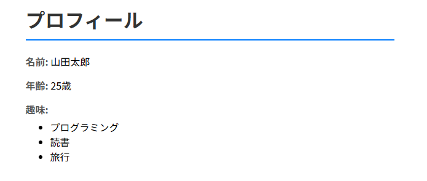

# profile-app-practice

## 概要
COACHTECH 教材 Tutorial 9-1「Laravel基礎ハンズオン」で作成した成果物です。 
Laravelを使用したプロフィール画面を作成しました。

## 使用技術
PHP 8.2 
Laravel 10.x 
Blade テンプレート

## 学んだこと
・ルーティング→コントローラー→ビューと進めていくLaravelの流れを学んだ。 
・ファイルがたくさんあるので、どこに何を入力するのかの理解に時間がかかった。今回もAIに聞きながら進めた。 
・Route::get、use など、使い慣れないコードも多いので、少しずつ慣れていけたらと思う。

## 動作確認
ブラウザを開くとエラー部分を教えてくれたので、それをヒントに作業をした。
 
 
